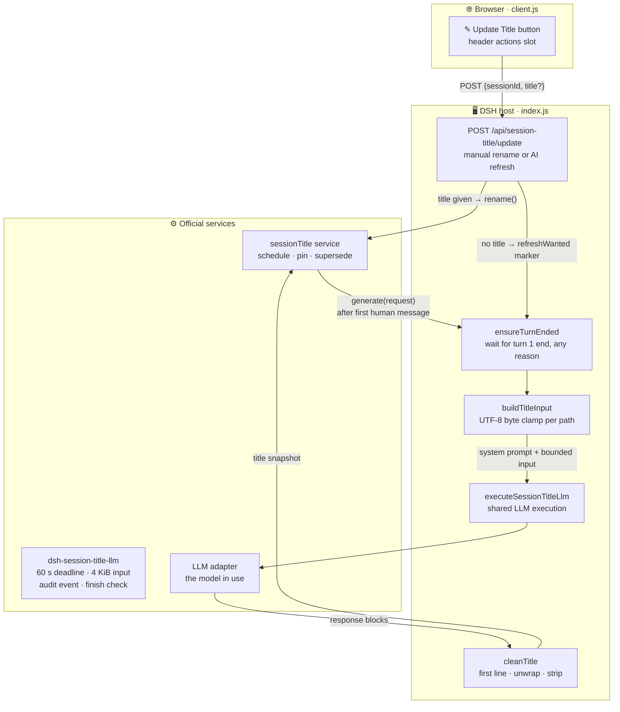

<div align="center">

# ✏️ dsh-smart-title

**Smart session titler for DeepSeek Harness (DSH) — the title summarizes the first FULL conversation turn, not just the opening prompt.**

*No token starvation · visible failure with one-click retry · locale-aware*

[](./index.js)

[](./client.js)
[](./LICENSE)

[Features](#-features) · [Architecture](#-architecture) · [The fixes](#-why-not-dsh-turn-title-the-fixes) · [Quick start](#-quick-start) · [API](#-api)

</div>

---

## 📖 What it is

`dsh-smart-title` is a session-title provider plugin for DeepSeek Harness (DSH). It registers with the official `sessionTitle` service and takes over titling from the built-in prompt-only titler: instead of naming the conversation from the first prompt alone, it **waits until the first FULL turn has ended** — user message plus the assistant's complete response, whatever the end reason — then summarizes the exchange into a short, action-focused title.

The built-in titler fires before the assistant even responds, so its titles miss everything the assistant actually did. This plugin disables it via a bundled cordis patch and owns the title from the moment turn 1 completes.

> 💡 **Titling principle** — name the ACTION and OBJECT of the exchange ("Fix login redirect", "修 smart-title 空标题 bug"), include concrete project/module/file names when mentioned, never a generic topic label, and write in the DSH UI language.

## ✨ Features

- 🕐 **Full-turn waiting** — `ensureTurnEnded` (index.js) resolves on `turn/end` for turn 1 with **any end reason** (completed, aborted, error, blocked, max-tokens); a snapshot → subscribe → re-check sequence means a turn ending in between cannot be missed.
- ✎ **Header button** — injected into the `conversation.session.header.actions` slot: **click** regenerates with AI over the conversation as it stands; **Shift+Click / Alt+Click** opens a manual rename box.
- 🛡️ **Visible failure** — a failed generation commits a localized placeholder title (「⚠ 标题未生成 · 点✎重试」) and logs a host warning; one ✎ click retries. No more silent `title: null`.
- 🌍 **Locale-aware** — title language follows the DSH UI locale (enforced by the system prompt); button text built in for en / zh / pt / pt-BR / ja.
- 🎨 **Native theme fit** — styled with `--dsw-alias-*` CSS variables; adapts to dark and light mode.
- 📌 **Respects the pin** — manually renamed titles are pinned by the service and never overwritten by the automatic path.

## 🏗️ Architecture



**Request flow** — ① ✎ click posts to the update endpoint → ② with a `title` it's a manual rename (`rename()`, pinned); without one it's an AI refresh marked via `refreshWanted` → ③ the provider's `generate()` waits for turn 1 (automatic path) or summarizes the conversation as it stands (refresh path) → ④ the shared LLM library executes with a 60 s deadline, 4 KiB input bound and audit event → ⑤ output is cleaned into a title and committed as a snapshot by the service.

## 🆚 Why not dsh-turn-title (the fixes)

| Problem in `dsh-turn-title` | `dsh-smart-title` |
|---|---|
| Titles from the first prompt only — fires before the assistant even responds | Waits for turn 1 to end (any reason) and summarizes both sides of the exchange |
| `maxTokens: 50` hardcoded — thinking models burn it all on reasoning, visible title empty | 4096-token output budget; `max-tokens` and `tool-calls` finish reasons are rejected as errors, not silently truncated |
| Empty output returned silently as `title: null` | Localized placeholder committed + host warning logged; ✎ button retries |
| Reasoning blocks pollute text extraction | Only `text` blocks are read, for both input assembly and output |
| No recovery path for a bad title | ✎ button always available: AI regenerate or manual rename |

**Reasoning effort** (design note, 2026-11-08): the title request uses the session's current `reasoningEffort` verbatim — exactly what the conversation window uses; nothing is lowered or picked here.

## 🧩 Design details

<details>
<summary><b>🕐 Turn-end waiting & race protection</b>（click to expand）</summary>

`ensureTurnEnded` first checks the session event snapshot for a `turn/end` of the target turn; if absent it subscribes to `session/event` and then **re-checks the snapshot after subscribing** — so a turn that ends between the two steps still resolves. The caller's abort signal rejects the promise (superseded rename, session disposal, plugin unload) and all listeners are cleaned up on settle.

</details>

<details>
<summary><b>📏 Bounded input, UTF-8-safe</b></summary>

Two input shapes, both clamped inside the shared library's 4 KiB bound:

| Path | Shape | Clamps |
|---|---|---|
| First turn | `User: …` + `Assistant: …` | 1400 + 2500 bytes |
| ✎ refresh | initial request + latest request + latest response | 1000 + 700 + 2100 bytes |

`clampUtf8` accumulates whole code points against the byte budget, so multi-byte characters are never split. Multi-step first turns use the **last** assistant message — it summarizes what was actually done.

</details>

<details>
<summary><b>🧼 Output hygiene</b></summary>

`extractResponseText` rejects `tool-calls` / `max-tokens` finish reasons outright. `firstTitleLine` takes the first non-empty line and unwraps whole-line emphasis (`**…**`, `***…***`) with a backreference regex — the closing marker must exactly equal the opening one, so greedy backtracking cannot steal a closer asterisk. `cleanTitle` strips surrounding HTML tags, quotes, markdown markers and trailing periods.

</details>

## 📦 Project structure

```
dsh-smart-title/
├── 📄 index.js          # Plugin body: sessionTitle provider + HTTP endpoint (host side)
├── 🌐 client.js         # Header ✎ button + locale strings (browser side)
├── 🩹 cordis.patch.yml  # Bundle patch: disables built-in early titler, inserts this plugin
├── 🌍 locale/           # Client-side string JSON (en / zh)
├── 🖼️ icon.svg          # Plugin icon
└── 📋 package.json      # DSH plugin manifest: peerDependencies / client inject / exports
```

## 🚀 Quick start

> Requires a DSH profile (`dsh >= 0.2.1-rc.3`) and `pnpm`. Local, linked install:

1️⃣ In the DSH profile's `package.json` (`~/.dsh/profiles/<name>/`), add the dependency:

```jsonc
"dependencies": {
  "dsh-smart-title": "file:D:/1/dsh-smart-title"
}
```

2️⃣ Enable the bundle in the same file:

```jsonc
"dsh": {
  "profile": {
    "bundles": [
      "dsh-smart-title"
    ]
  }
}
```

3️⃣ Install and restart DSH:

```powershell
cd ~/.dsh/profiles/<name>
pnpm install
# then restart DSH
```

4️⃣ Try it:

1. Start a new conversation and ask anything — when the first full turn completes, the sidebar title becomes an AI-generated action+object title.
2. Click **✎ Update Title** in the chat header — the title is regenerated over the conversation as it stands.
3. **Shift+Click** the button — enter a manual title (pinned, never auto-overwritten).
4. If a generation fails, a ⚠ placeholder appears — click ✎ to retry.

The bundled `cordis.patch.yml` disables the built-in early titler (`session-title-llm`) so the full-turn titler owns the title.

## 🔌 API

`POST /api/session-title/update`

| Body | Effect |
|---|---|
| `{ "sessionId": "session-…" }` | AI regeneration over the conversation as it stands |
| `{ "sessionId": "session-…", "title": "新标题" }` | Manual rename (cleaned, then pinned) |

Responses: `{ "ok": true, "title": "…" }`, or `{ "error": "…" }` with `405` (wrong method) / `400` (missing sessionId, invalid rename) / `404` (unknown session) / `500` (internal).

---

<div align="center">

**dsh-smart-title** — titles that know what actually happened.

MIT © lenovo

</div>
