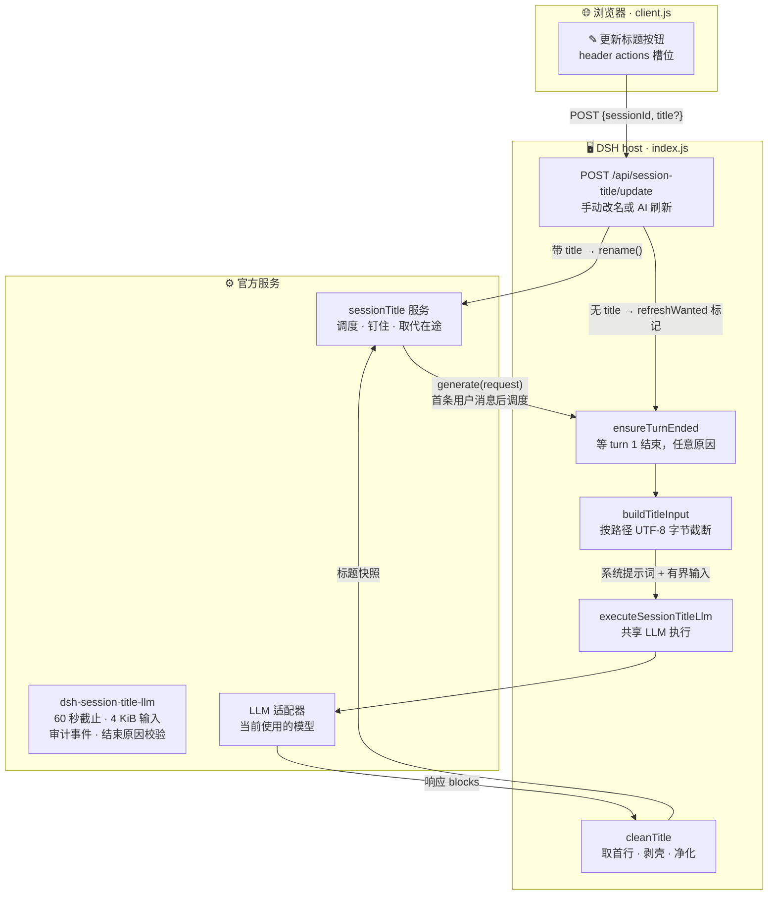

<div align="center">

# ✏️ dsh-smart-title

**DeepSeek Harness（DSH）智能会话标题插件——标题总结第一轮完整对话，而非只看首条提问。**

*不饿死思考 token · 失败可见一键重试 · 语言跟随界面*

[](./index.js)

[](./client.js)
[](./LICENSE)

[功能全景](#-功能全景) · [架构总览](#-架构总览) · [修复点](#-对-dsh-turn-title-的修复点) · [快速开始](#-快速开始) · [API](#-api)

</div>

---

## 📖 它是什么

`dsh-smart-title` 是 DeepSeek Harness（DSH）的会话标题 provider 插件。它向官方 `sessionTitle` 服务注册并接管内置「只看提问」起标题插件的工作：不再只凭首条提问给会话起名，而是**等第一轮完整对话结束**——用户提问加助手完整回复，无论以何种原因结束——再把这段交流总结成一个短标题。

内置插件在助手还没回复时就会起标题，标题完全看不到助手实际做了什么。本插件通过自带的 cordis 补丁停用它，从第 1 轮结束那一刻起接管标题。

> 💡 **起标题原则**——标题写交流的「动作 + 对象」（如 "Fix login redirect"、"修 smart-title 空标题 bug"），提到具体项目/模块/文件名就带上，不写泛泛的话题标签，语言跟随 DSH 界面语言。

## ✨ 功能全景

- 🕐 **整轮等待** — `ensureTurnEnded`（index.js）在 turn 1 的 `turn/end` 事件上解决，**任意结束原因**都算（完成、中止、出错、拦截、封顶）；快照 → 订阅 → 复查三步防竞态，瞬间结束的一轮也不会漏。
- ✎ **头部按钮** — 注入 `conversation.session.header.actions` 槽位：**单击**按对话现状用 AI 重新生成；**Shift+单击 / Alt+单击**弹出输入框手动改名。
- 🛡️ **失败可见** — 生成失败时提交本地化占位标题（「⚠ 标题未生成 · 点✎重试」）并记 host 警告；点一下 ✎ 即重试。不再静默返回 `title: null`。
- 🌍 **语言跟随** — 标题语言跟随 DSH 界面语言（由系统提示词强制）；按钮文案内置 en / zh / pt / pt-BR / ja。
- 🎨 **原生主题融合** — 使用 `--dsw-alias-*` CSS 变量，深浅色模式都适配。
- 📌 **尊重改名钉住** — 手动改名的标题由服务钉住，自动路径永不覆盖。

## 🏗️ 架构总览



**请求链路** — ① 点击 ✎ 调用更新端点 → ② 带 `title` 即手动改名（`rename()`，钉住）；不带即 AI 刷新，经 `refreshWanted` 标记 → ③ provider 的 `generate()` 在自动路径等 turn 1 结束，刷新路径直接总结对话现状 → ④ 共享 LLM 库以 60 秒截止、4 KiB 输入上限和审计事件执行 → ⑤ 输出净化成标题，由服务提交快照。

## 🆚 对 dsh-turn-title 的修复点

| `dsh-turn-title` 的问题 | `dsh-smart-title` 的做法 |
|---|---|
| 只看首条提问起标题——助手还没回复就开写 | 等 turn 1 结束（任意原因）后总结双方内容 |
| 写死 `maxTokens: 50`——思考型模型把 50 个 token 全烧在思考上，正文 0 字 | 输出预算 4096；`max-tokens` 与 `tool-calls` 结束原因按错误拒绝，绝不静默截断 |
| 空输出静默返回 `title: null` | 提交本地化占位标题 + host 警告日志；✎ 按钮重试 |
| reasoning 块污染文本提取 | 输入组装与输出提取都只读 `text` 块 |
| 标题不满意没有补救路径 | ✎ 按钮随时可用：AI 重新生成或手动改名 |

**推理档位**（设计共识，2026-11-08）：标题请求原样使用会话当前的 `reasoningEffort`——与对话窗口完全一致，此处不做降档也不做挑选。

## 🧩 设计细节

<details>
<summary><b>🕐 整轮等待与防竞态</b>（点击展开）</summary>

`ensureTurnEnded` 先查会话事件快照里是否已有目标 turn 的 `turn/end`；没有则订阅 `session/event`，并在订阅后**再查一次快照**——恰好夹在两步之间结束的一轮同样能解决。调用方的 abort 信号会 reject（改名被取代、会话销毁、插件卸载），settle 时统一清理所有监听器。

</details>

<details>
<summary><b>📏 有界输入，UTF-8 安全</b></summary>

两种输入形态，都钳制在共享库 4 KiB 预算内：

| 路径 | 形态 | 截断配额 |
|---|---|---|
| 第一轮 | `User: …` + `Assistant: …` | 1400 + 2500 字节 |
| ✎ 刷新 | 首条请求 + 最新请求 + 最新回复 | 1000 + 700 + 2100 字节 |

`clampUtf8` 按字节预算逐码点累积，多字节字符绝不切半。多步首轮取**最后一条**助手消息——它总结了实际做了什么。

</details>

<details>
<summary><b>🧼 输出净化</b></summary>

`extractResponseText` 直接拒绝 `tool-calls` / `max-tokens` 结束原因。`firstTitleLine` 取首个非空行，并用反引用正则解开整行强调包裹（`**…**`、`***…***`）——闭合标记必须与开头完全一致，贪婪回溯偷不走内侧星号。`cleanTitle` 剥掉首尾 HTML 标签、引号、markdown 记号与结尾句点。

</details>

## 📦 项目结构

```
dsh-smart-title/
├── 📄 index.js          # 插件主体：sessionTitle provider + HTTP 端点（host 侧）
├── 🌐 client.js         # 聊天头部 ✎ 按钮 + 多语言文案（浏览器侧）
├── 🩹 cordis.patch.yml  # 打包补丁：停用内置早期起标题插件，插入本插件
├── 🌍 locale/           # 客户端文案 JSON（en / zh）
├── 🖼️ icon.svg          # 插件图标
└── 📋 package.json      # DSH 插件清单：peerDependencies / client 注入 / exports
```

## 🚀 快速开始

> 需要 DSH profile（`dsh >= 0.2.1-rc.3`）与 `pnpm`。本地链接安装：

1️⃣ 在 DSH profile 的 `package.json`（`~/.dsh/profiles/<name>/`）加依赖：

```jsonc
"dependencies": {
  "dsh-smart-title": "file:D:/1/dsh-smart-title"
}
```

2️⃣ 同一文件里启用 bundle：

```jsonc
"dsh": {
  "profile": {
    "bundles": [
      "dsh-smart-title"
    ]
  }
}
```

3️⃣ 安装并重启 DSH：

```powershell
cd ~/.dsh/profiles/<name>
pnpm install
# 然后重启 DSH
```

4️⃣ 体验：

1. 新建会话随便提问——第一轮完整对话结束时，侧栏标题变成 AI 生成的「动作+对象」标题。
2. 点击聊天头部**「✎ 更新标题」**——按对话现状重新生成。
3. **Shift+单击**按钮——输入手动标题（钉住，永不被自动覆盖）。
4. 生成失败会出现 ⚠ 占位标题——点 ✎ 重试。

插件自带的 `cordis.patch.yml` 会停用内置早期起标题插件（`session-title-llm`），让「完整一轮」标题接管。

## 🔌 API

`POST /api/session-title/update`

| 请求体 | 效果 |
|---|---|
| `{ "sessionId": "session-…" }` | 按对话现状 AI 重新生成 |
| `{ "sessionId": "session-…", "title": "新标题" }` | 手动改名（先净化再钉住） |

响应：`{ "ok": true, "title": "…" }`，或 `{ "error": "…" }` 配 `405`（方法不对）/ `400`（缺 sessionId、改名非法）/ `404`（会话不存在）/ `500`（内部错误）。

---

<div align="center">

**dsh-smart-title** — 标题知道对话真正发生了什么。

MIT © lenovo

</div>
